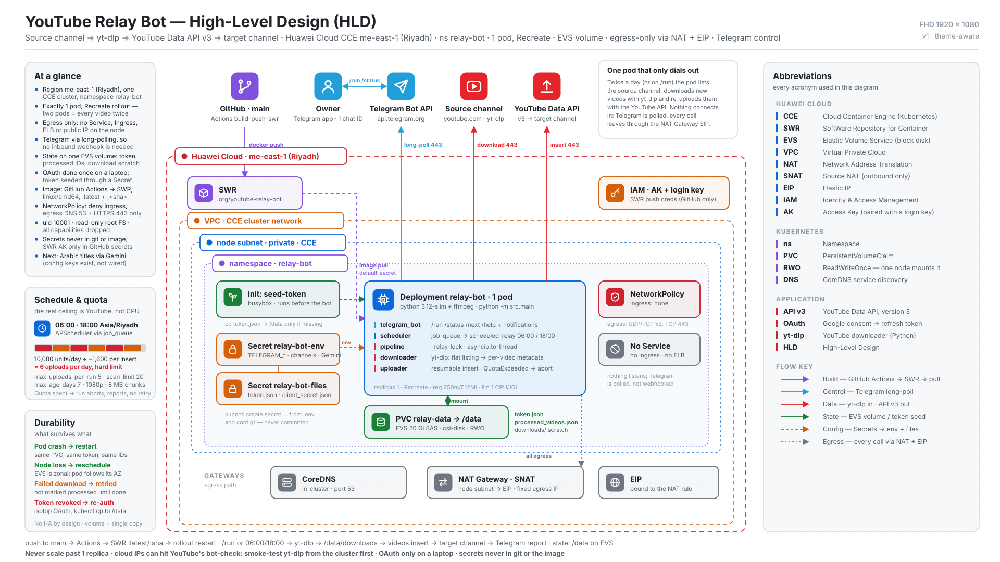

# YouTube Relay Bot

Automated pipeline that downloads new videos from a source YouTube channel and re-uploads them to a target channel. Controlled via a Telegram bot, with scheduled runs at 06:00 and 18:00 Asia/Riyadh.

## Features

- Scheduled relay twice daily, times and timezone configurable
- Telegram control: `/run`, `/status`, `/next`, `/help`, plus run notifications
- Keeps the original title and description, appends a source credit
- Tracks processed video IDs — no duplicate uploads
- Runs as one pod on Huawei Cloud CCE (`me-east-1`, Riyadh), egress-only, state on an EVS volume
- Resumable uploads with backoff; aborts cleanly when the daily API quota is spent

## Architecture



The diagram follows the viewer's light/dark theme. Edit `docs/hld/gen_hld.py` and run `python3 docs/hld/gen_hld.py` to regenerate it, never the SVG by hand.

```
GitHub main ──Actions──▶ Docker Hub  docker.io/ibn3bbas/youtube-relay-bot:{latest,<sha>}  (private)
                           │ image pull via NAT (Secret dockerhub-pull)
                           ▼
CCE · namespace relay-bot
  Deployment relay-bot   1 replica · strategy Recreate · uid 10001 · read-only root FS
    initContainer seed-token   copies token.json onto the volume once
    bot container              telegram_bot · scheduler · pipeline (downloader → uploader)
  Secret relay-bot-env         .env → environment
  Secret relay-bot-files       token.json · client_secret.json
  PVC relay-data (EVS 20 Gi)   /data: token.json · processed_videos.json · downloads/
  Secret dockerhub-pull        read-only Docker Hub token
  NetworkPolicy                ingress none · egress 53 + 443
        │ all egress
        ▼
NAT Gateway (SNAT) + EIP ──▶ api.telegram.org · youtube.com (yt-dlp) · YouTube Data API v3 · Docker Hub
```

No Service, Ingress or load balancer: Telegram is long-polled, so nothing connects in.

## Deployment

Bash only. Full runbook: **[docs/deploy-cce.md](docs/deploy-cce.md)**.

1. **Registry.** Create the Docker Hub repo `ibn3bbas/youtube-relay-bot` as **private**. Make a Read & Write access token
   and store it as the repo secret `DOCKERHUB_TOKEN` (`gh secret set DOCKERHUB_TOKEN`).
2. **Image.** Push to `main` (or run `build-push-dockerhub` by hand). Actions builds `linux/amd64` and pushes `:latest` + `:<sha>`.
3. **OAuth, once, on a laptop.** The pod cannot open a browser. Produce `config/token.json` locally.
4. **Cluster.**

```bash
kubectl create ns relay-bot
kubectl -n relay-bot create secret docker-registry dockerhub-pull \
  --docker-server=https://index.docker.io/v1/ --docker-username=ibn3bbas \
  --docker-password=<read-only token>
kubectl -n relay-bot create secret generic relay-bot-env --from-env-file=.env
kubectl -n relay-bot create secret generic relay-bot-files \
  --from-file=token.json=config/token.json \
  --from-file=client_secret.json=config/client_secret.json
kubectl apply -f k8s/relay-bot.yaml
kubectl -n relay-bot logs -f deploy/relay-bot
```

Keep `replicas: 1` and `strategy: Recreate`. Two pods means every video is uploaded twice.

The earlier WSL2/systemd install (`deploy/wsl/`, [docs/wsl-deployment.md](docs/wsl-deployment.md)) is kept as a fallback and is no longer the primary path. `docker-compose.yml` is for local development only.

## Configuration

`config/config.yaml` holds the defaults; `.env` overrides any of them. Copy `.env.example` to `.env` and fill in at minimum:

```env
TELEGRAM_BOT_TOKEN=...
TELEGRAM_ALLOWED_CHAT_ID=...
```

Telegram token from [@BotFather](https://t.me/BotFather); chat ID from [@userinfobot](https://t.me/userinfobot).

YouTube credentials: Google Cloud Console -> enable **YouTube Data API v3** -> create an OAuth 2.0 Client ID of type **Desktop app** -> download the JSON to `config/client_secret.json`. Run the OAuth flow once locally (runbook step 1, or `tools/oauth_bootstrap.py` on a headless box) to produce `config/token.json`.

## Telegram commands

| Command | Description |
|---------|-------------|
| `/run` | Trigger the relay pipeline immediately |
| `/status` | Last run summary (or "running" if one is in flight) |
| `/next` | Next scheduled run times |
| `/help` | Show available commands |

## Operations

```bash
kubectl -n relay-bot get pod -l app=relay-bot
kubectl -n relay-bot logs -f deploy/relay-bot
kubectl -n relay-bot rollout restart deploy/relay-bot        # pick up a new :latest
kubectl -n relay-bot exec deploy/relay-bot -- cat /data/processed_videos.json
```

## Quota

A video insert costs ~1,600 YouTube Data API units against a 10,000/day default — roughly **six uploads per day**. `max_uploads_per_run` in `config.yaml` defaults to 5 to stay inside that. When the quota is exhausted the run aborts and reports it rather than retrying.

## Optional: Gemini

```env
GEMINI_API_KEY=your_key_here
GEMINI_ENABLED=true
```

Free key at [aistudio.google.com](https://aistudio.google.com). Intended for Arabic translation of titles and descriptions — the config keys exist, the translation step is not yet implemented.

## Project structure

```
Project-12-YouTube-Relay-Bot/
├── src/
│   ├── main.py            # entry point, logging setup
│   ├── config.py          # layered config loader
│   ├── downloader.py      # yt-dlp discovery + download
│   ├── uploader.py        # YouTube Data API v3 upload
│   ├── pipeline.py        # download -> upload orchestration
│   ├── scheduler.py       # daily job registration
│   └── telegram_bot.py    # command handlers
├── tools/
│   └── oauth_bootstrap.py # headless OAuth consent
├── k8s/relay-bot.yaml     # CCE: namespace, PVC, Deployment, NetworkPolicy
├── .github/workflows/
│   └── build-push-dockerhub.yml # image → Docker Hub
├── deploy/wsl/            # fallback: WSL2 + systemd scripts
├── config/config.yaml     # application defaults
├── docs/
│   ├── deploy-cce.md      # runbook (primary)
│   ├── hld/               # HLD diagram + generator
│   └── wsl-deployment.md  # fallback runbook
├── Dockerfile
├── docker-compose.yml     # local dev only
├── .env.example
└── requirements.txt
```

## License

Internal use only.
